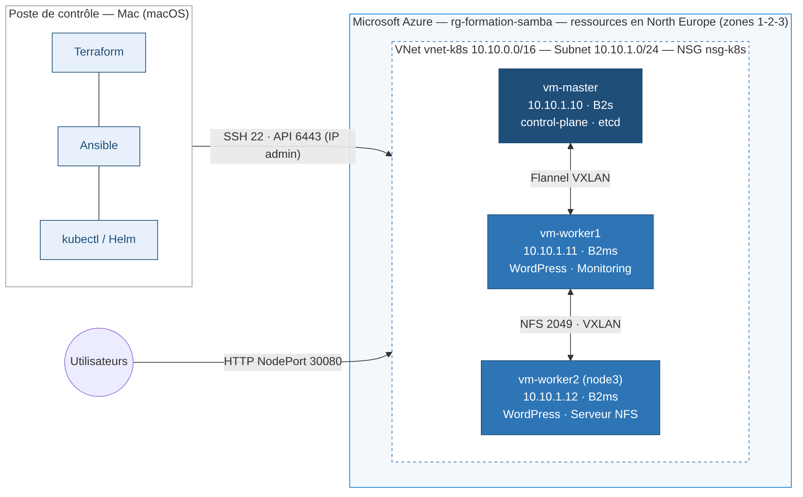
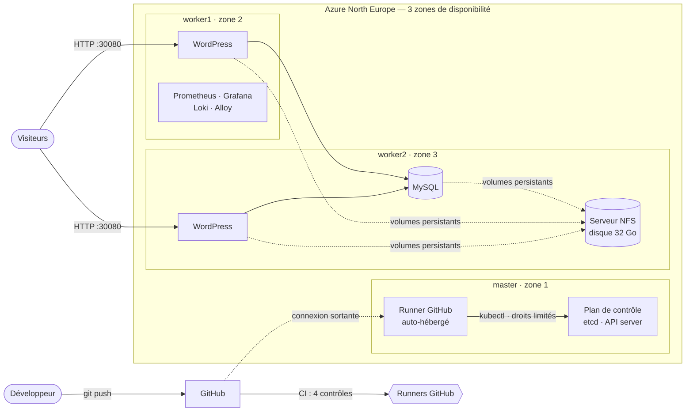
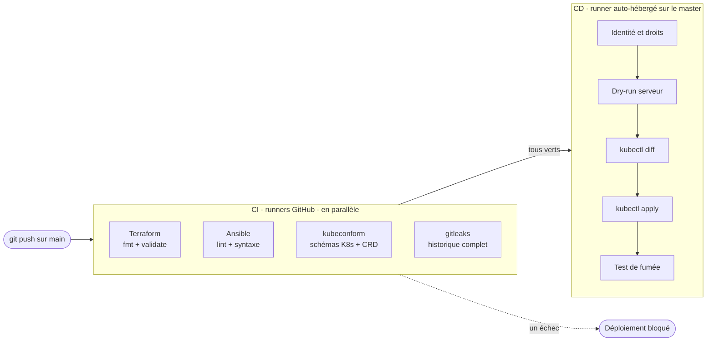

<div align="center">

# WordPress haute disponibilité sur Kubernetes dans Azure

**Plateforme e-commerce WordPress / MySQL entièrement automatisée : de l'infrastructure cloud à la mise en production continue.**

[](https://github.com/sambagdg/azure-k8s-wordpress-ha/actions/workflows/ci.yml)
[](https://github.com/sambagdg/azure-k8s-wordpress-ha/actions/workflows/cd.yml)


*Projet réalisé dans le cadre du titre professionnel **Administrateur Système DevOps** (RNCP36061 — niveau 6)*

</div>

---

## Sommaire

- [En bref](#en-bref)
- [Architecture](#architecture)
- [Stack technique](#stack-technique)
- [Fonctionnalités](#fonctionnalités)
- [Structure du dépôt](#structure-du-dépôt)
- [Déploiement pas à pas](#déploiement-pas-à-pas)
- [CI/CD avec GitHub Actions](#cicd-avec-github-actions)
- [Supervision, logs et alertes](#supervision-logs-et-alertes)
- [Sauvegarde et restauration](#sauvegarde-et-restauration)
- [Tests et validation](#tests-et-validation)
- [Sécurité](#sécurité)
- [Défis techniques résolus](#défis-techniques-résolus)
- [Limites connues et évolutions](#limites-connues-et-évolutions)
- [Auteur](#auteur)

---

## En bref

| | |
|---|---|
| **Objectif** | Mettre en production une application WordPress / MySQL **hautement disponible**, **automatisée de bout en bout**, **supervisée** et **sauvegardée** |
| **Infrastructure** | 3 VM Azure réparties sur **3 zones de disponibilité**, provisionnées par **Terraform** |
| **Configuration** | Cluster **Kubernetes 1.35** monté par **Ansible** et kubeadm (8 rôles, profil `production` d'ansible-lint) |
| **Application** | WordPress (3 à 6 réplicas, autoscaling) + MySQL 8.4, stockage persistant **NFS** |
| **Observabilité** | Prometheus, Grafana, Alertmanager, sonde HTTP, **6 règles d'alerte**, logs centralisés avec **Loki** |
| **Sauvegarde** | etcd (Ansible + cron) et MySQL (CronJob), **restauration testée** |
| **CI/CD** | **4 contrôles** automatiques, déploiement continu par un **runner auto-hébergé** aux droits limités |
| **Validation** | **27 tests automatiques** au vert, cahier de recette de **23 tests** |

---

## Architecture





| Nœud | Rôle | Taille Azure | IP privée | Zone |
|---|---|---|---|---|
| **master** | Plan de contrôle Kubernetes, etcd, runner CI/CD | Standard_B2s (2 vCPU / 4 Go) | 10.10.1.10 | 1 |
| **worker1** | Pods WordPress, supervision | Standard_B2ms (2 vCPU / 8 Go) | 10.10.1.11 | 2 |
| **worker2** | Pods WordPress, MySQL, serveur NFS (disque dédié) | Standard_B2ms (2 vCPU / 8 Go) | 10.10.1.12 | 3 |

**Réseau** : VNet `10.10.0.0/16`, réseau des pods `10.244.0.0/16` (Flannel VXLAN), réseau des Services `10.96.0.0/12`.
**Exposition** : WordPress en NodePort `30080` (public), Grafana en NodePort `30300` et API Kubernetes `6443` (réservés à l'IP de l'administrateur).

---

## Stack technique

| Domaine | Outils | Points clés |
|---|---|---|
| **Cloud** | Microsoft Azure | VNet, NSG, IP statiques, disques managés, zones de disponibilité |
| **Infrastructure as Code** | Terraform (`azurerm` 4.x) | `for_each`, groupe de ressources existant (`data`), génération de l'inventaire Ansible |
| **Configuration** | Ansible | 8 rôles, idempotence prouvée, `requirements.yml`, ansible-lint niveau `production` |
| **Orchestration** | Kubernetes 1.35 (kubeadm) | containerd 2.2, Flannel VXLAN, 3 nœuds |
| **Stockage** | NFS | PersistentVolumes statiques : RWO (MySQL), RWX (WordPress) |
| **Haute disponibilité** | Deployment, HPA, PDB | 3 à 6 réplicas, répartition par nœud, metrics-server |
| **Supervision** | kube-prometheus-stack, blackbox-exporter | Tableaux de bord Grafana, sonde HTTP, Alertmanager |
| **Logs** | Loki, Grafana Alloy | Logs des pods et événements Kubernetes, requêtes LogQL |
| **Sauvegarde** | etcdctl / etcdutl, mysqldump | Rétention de 7 copies, stockage hors du nœud protégé |
| **CI/CD** | GitHub Actions | Runner auto-hébergé, ServiceAccount RBAC, test de fumée |
| **Qualité / sécurité** | ansible-lint, kubeconform, gitleaks | Exécutés à chaque push |

---

## Fonctionnalités

- **Infrastructure reproductible** : un `terraform apply` recrée réseau, pare-feu, VM et disque NFS à l'identique.
- **Cluster monté en une commande** : `ansible-playbook site.yml` prépare les nœuds, initialise le cluster et y joint les workers.
- **Dépendance applicative garantie** : un *initContainer* empêche WordPress de démarrer tant que MySQL ne répond pas.
- **Données persistantes** : base et fichiers WordPress survivent à la suppression de tous les pods.
- **Auto-réparation et autoscaling** : un pod supprimé est remplacé en ~11 s, et WordPress passe de 3 à 6 réplicas sous charge.
- **Maintenance sans coupure** : `PodDisruptionBudget` (au moins 2 pods WordPress disponibles en permanence).
- **Observabilité complète** : métriques, temps de réponse, logs et alertes dans une même interface Grafana.
- **Sauvegardes automatiques** et procédure de restauration documentée.
- **Mise en production continue** : un `git push` sur `main` déploie l'application, uniquement si tous les contrôles sont verts.

---

## Structure du dépôt

```
.
├── .github/workflows/
│   ├── ci.yml                  # Contrôles qualité et sécurité (4 jobs)
│   └── cd.yml                  # Déploiement continu (runner auto-hébergé)
├── terraform/                  # Infrastructure Azure
│   ├── providers.tf · variables.tf · network.tf · compute.tf · outputs.tf
│   └── templates/inventory.tftpl   # Inventaire Ansible généré
├── ansible/
│   ├── site.yml                # Configuration complète du cluster
│   ├── backup.yml              # Sauvegarde etcd
│   ├── ci-runner.yml           # Installation du runner GitHub
│   ├── requirements.yml        # Collections Ansible requises
│   └── roles/                  # common · containerd · kubernetes · master · workers
│                               # nfs_server · etcd_backup · github_runner
├── kubernetes/
│   ├── 00-namespace.yaml … 07-mysql-backup-cronjob.yaml
│   ├── ci/github-deployer-rbac.yaml    # Identité limitée du pipeline
│   └── addons/metrics-server-values.yaml
├── monitoring/                 # kube-prometheus-stack, blackbox, sonde, règles d'alerte
├── logging/                    # Loki, Grafana Alloy
├── tests/
│   ├── validation.sh           # 27 vérifications de la plateforme
│   └── smoke.sh                # Test de fumée post-déploiement
├── documentation/
│   ├── cahier-de-recette.md
│   └── runbook-restauration-etcd.md
└── docs/architecture.png
```

---

## Déploiement pas à pas

### Prérequis

- Un abonnement Azure et Azure CLI (`az login`)
- Terraform ≥ 1.6, Ansible ≥ 2.18, kubectl, Helm, GitHub CLI
- Une clé SSH dédiée : `ssh-keygen -t ed25519 -f ~/.ssh/azure_k8s`

### 1. Infrastructure

```bash
cd terraform
cp terraform.tfvars.example terraform.tfvars        # renseigner admin_ip
export ARM_SUBSCRIPTION_ID=$(az account show --query id -o tsv)
terraform init && terraform apply
```

→ 3 VM, réseau, NSG, disque NFS, et `ansible/inventory.ini` généré automatiquement.

### 2. Cluster Kubernetes et stockage NFS

```bash
cd ../ansible
ansible-galaxy collection install -r requirements.yml
ansible-playbook site.yml
export KUBECONFIG=$PWD/../.kube/config
kubectl get nodes                                    # 3 nœuds Ready
```

### 3. Application

```bash
cd ..
# Secret créé hors du dépôt (jamais versionné)
mkdir -p .secrets
cat > .secrets/mysql.env <<EOF
MYSQL_ROOT_PASSWORD=$(openssl rand -base64 24 | tr -d '/+=')
MYSQL_PASSWORD=$(openssl rand -base64 24 | tr -d '/+=')
EOF
kubectl apply -f kubernetes/00-namespace.yaml
kubectl create secret generic mysql-secret -n gandega-project1 --from-env-file=.secrets/mysql.env
kubectl apply -f kubernetes/
```

→ WordPress disponible sur `http://<IP d'un nœud>:30080`.

### 4. Haute disponibilité, supervision et logs

```bash
helm repo add metrics-server https://kubernetes-sigs.github.io/metrics-server/
helm repo add prometheus-community https://prometheus-community.github.io/helm-charts
helm repo add grafana https://grafana.github.io/helm-charts && helm repo update

helm upgrade --install metrics-server metrics-server/metrics-server -n kube-system \
  -f kubernetes/addons/metrics-server-values.yaml

kubectl create namespace monitoring
kubectl create secret generic grafana-admin -n monitoring \
  --from-literal=admin-user=admin --from-literal=admin-password="$(openssl rand -base64 18)"

helm upgrade --install monitoring prometheus-community/kube-prometheus-stack -n monitoring \
  -f monitoring/kube-prometheus-stack-values.yaml
helm upgrade --install blackbox prometheus-community/prometheus-blackbox-exporter -n monitoring \
  -f monitoring/blackbox-values.yaml
kubectl apply -f monitoring/probe-wordpress.yaml -f monitoring/alert-rules.yaml

helm upgrade --install loki grafana/loki -n monitoring -f logging/loki-values.yaml
helm upgrade --install alloy grafana/alloy -n monitoring -f logging/alloy-values.yaml
```

→ Grafana sur `http://<IP d'un nœud>:30300`.

### 5. Sauvegardes et CI/CD

```bash
cd ansible && ansible-playbook backup.yml && cd ..         # etcd : sauvegarde + cron quotidien
kubectl apply -f kubernetes/ci/github-deployer-rbac.yaml    # identité limitée du pipeline

cd ansible
RUNNER_TOKEN=$(gh api -X POST repos/<owner>/<repo>/actions/runners/registration-token --jq .token)
ansible-playbook ci-runner.yml -e "github_runner_token=$RUNNER_TOKEN"
```

### 6. Validation

```bash
./tests/validation.sh          # == Résultat : 27 réussis, 0 en échec
```

---

## CI/CD avec GitHub Actions



| Workflow | Déclencheur | Exécution | Rôle |
|---|---|---|---|
| **CI** (`ci.yml`) | Chaque push et pull request | Runners GitHub (`ubuntu-24.04`) | Valide Terraform, Ansible et Kubernetes, détecte les secrets |
| **CD** (`cd.yml`) | Push sur `main` modifiant `kubernetes/`, ou déclenchement manuel | Runner auto-hébergé (`azure-k8s`) | Rejoue la CI, puis déploie et vérifie l'application |

**Garanties du pipeline :**

- **Aucun déploiement sans CI verte** (`needs: ci`) : un manifeste invalide ou un secret committé n'atteint jamais le cluster.
- **Aucun port entrant** : le runner contacte GitHub par une connexion sortante, l'API Kubernetes reste fermée à Internet.
- **Moindre privilège** : le pipeline agit sous le ServiceAccount `github-deployer`, limité au namespace de l'application.

| Action du pipeline | Autorisée |
|---|:---:|
| Créer / modifier Deployments, Services, ConfigMaps, HPA, PDB, CronJobs | ✅ |
| Supprimer une ressource | ❌ |
| Lire les Secrets | ❌ |
| Voir les nœuds ou les autres namespaces | ❌ |

- **Un seul déploiement à la fois** (`concurrency`), historique des mises en production dans l'environnement GitHub `production`.

---

## Supervision, logs et alertes

| Besoin | Solution |
|---|---|
| État des nœuds, CPU, RAM, disque | node-exporter + tableau de bord *Node Exporter / Nodes* |
| État et consommation des pods | kube-state-metrics + tableaux de bord *Compute Resources* |
| Disponibilité et **temps de réponse** de l'application | blackbox-exporter : sonde HTTP toutes les 30 s (`probe_success`, `probe_duration_seconds`) |
| Logs WordPress, MySQL et événements Kubernetes | Grafana Alloy → Loki, recherche dans Grafana *Explore* (LogQL) |

**Règles d'alerte du projet** (`monitoring/alert-rules.yaml`) :

| Alerte | Condition | Sévérité |
|---|---|---|
| `NoeudCPUEleve` | CPU d'un nœud > 80 % pendant 2 min | warning |
| `MySQLIndisponible` | Aucun pod MySQL disponible depuis 1 min | critical |
| `WordPressReplicasInsuffisants` | Moins de 2 pods WordPress disponibles | critical |
| `PodRedemarrages` | Plus de 2 redémarrages en 10 min | warning |
| `WordPressInaccessible` | La sonde HTTP échoue depuis 1 min | critical |
| `WordPressLent` | Temps de réponse > 2 s pendant 5 min | warning |

Exemples de requêtes LogQL :

```logql
{namespace="gandega-project1", app="wordpress"} != "kube-probe"
sum by (pod) (count_over_time({namespace="gandega-project1", app="wordpress"} != "kube-probe" [1m]))
{job="loki.source.kubernetes_events"} |= "mysql"
```

---

## Sauvegarde et restauration

| Sauvegarde | Contenu | Méthode | Fréquence | Rétention |
|---|---|---|---|---|
| **etcd** | État complet du cluster (tous les objets Kubernetes) | Rôle Ansible `etcd_backup` : `etcdctl snapshot save` + vérification `etcdutl` | Quotidienne (01h30, cron) | 7 copies |
| **MySQL** | Données de l'application | CronJob `mysql-backup` : `mysqldump --single-transaction` | Quotidienne (02h00) | 7 copies |

Les sauvegardes sont stockées sur le **serveur NFS (worker2)**, hors du nœud qu'elles protègent.

- **Restauration MySQL testée** : un article supprimé a été récupéré à partir du dump.
- **Restauration etcd** : procédure documentée dans [`documentation/runbook-restauration-etcd.md`](documentation/runbook-restauration-etcd.md).

---

## Tests et validation

**`tests/validation.sh`** vérifie la plateforme en 27 points, regroupés en 7 blocs :

```
== 1. Cluster                    ✅ 2/2
== 2. Application                ✅ 8/8
== 3. Accès HTTP (3 nœuds)       ✅ 3/3
== 4. Haute disponibilité        ✅ 4/4
== 5. Supervision                ✅ 5/5
== 6. Logs                       ✅ 2/2
== 7. Sauvegardes                ✅ 3/3
== Résultat : 27 réussis, 0 en échec
```

**Tests de résilience réalisés** (détail dans le [cahier de recette](documentation/cahier-de-recette.md)) :

| Scénario | Résultat |
|---|---|
| Suppression d'un pod WordPress sous trafic | 100 % de réponses HTTP 200, remplacement en ~11 s |
| Suppression des 3 pods WordPress | Fichiers téléversés toujours servis (volume RWX) |
| Suppression du pod MySQL | Données intactes |
| Mise en maintenance d'un nœud (`kubectl drain`) | Bascule automatique, WordPress attend MySQL (*initContainer*) |
| Arrêt puis redémarrage des 3 VM | Plateforme opérationnelle sans intervention |
| Test de charge (8 clients) | Autoscaling de 3 à 6 réplicas, puis retour à 3 |
| Panne MySQL simulée | Alertes déclenchées, cause identifiée par les logs |

---

## Sécurité

- **Aucun secret dans le dépôt** : mots de passe générés et injectés en Secrets Kubernetes, `terraform.tfvars`, kubeconfig et état Terraform exclus de Git, historique vérifié par **gitleaks** à chaque push.
- **Accès réseau restreints** : SSH, API Kubernetes et Grafana ouverts à la seule IP de l'administrateur (NSG), authentification SSH par clé uniquement.
- **Moindre privilège** : runner sous un utilisateur dédié sans `sudo`, ServiceAccount RBAC limité, jeton `GITHUB_TOKEN` en lecture seule.
- **Dépôt public protégé** : approbation obligatoire des workflows provenant de forks, CD déclenché uniquement sur `main`.
- **Gouvernance Azure respectée** : droits RBAC limités au groupe de ressources, Azure Policy sur les tailles de VM, quotas par région.
- **Applications immuables** : mises à jour automatiques de WordPress désactivées, versions figées (Kubernetes, MySQL, etcd, runners).

---

## Défis techniques résolus

| Problème rencontré | Cause identifiée | Solution |
|---|---|---|
| Création des VM refusée (`RequestDisallowedByPolicy`) | Azure Policy limitant les tailles de VM + quota BS saturé en France Central | Croisement policy × quotas → B2s/B2ms en North Europe |
| Page WordPress `Forbidden`, puis boucle de redirection | La `livenessProbe` tuait le conteneur pendant la copie initiale des fichiers sur NFS | `startupProbe` (5 min) + initContainer de vérification des droits |
| Site en `503` sur tous les pods | Mise à jour automatique interrompue : fichier `.maintenance` laissé sur le volume partagé | Désactivation des mises à jour automatiques (immutabilité) |
| Autoscaling inefficace pendant le test de charge | Redirection canonique de WordPress vers un port inexistant | En-tête `Host` adapté dans les tests et la sonde HTTP |
| Loki en `CrashLoopBackOff` | Système de fichiers en lecture seule sans volume de données | Volume `emptyDir` monté sur `/var/loki` |
| gitleaks : 100 secrets détectés | Cache de collections Ansible committé par erreur | `.gitignore`, `git filter-repo`, sortie `--redact` |

---

## Limites connues et évolutions

| Limite | Évolution envisagée |
|---|---|
| MySQL en instance unique (~1 min d'indisponibilité si son nœud tombe) | Réplication MySQL (StatefulSet / opérateur) |
| Un seul nœud de plan de contrôle | Cluster multi-master avec etcd répliqué |
| Capacité plafonnée à 2 workers | Cluster Autoscaler (VM Scale Sets ou AKS) |
| HTTP sans chiffrement | Ingress Controller + certificats TLS (cert-manager) et nom de domaine |
| Secrets non chiffrés dans etcd | Chiffrement au repos (`EncryptionConfiguration`) ou gestionnaire externe (Azure Key Vault) |
| Logs Loki non persistants (3 jours, `emptyDir`) | Stockage objet (Azure Blob) |
| RPO de 24 h pour MySQL | Sauvegardes plus fréquentes ou basées sur les binlogs |
| Notifications d'alertes non routées | Alertmanager → e-mail, Slack ou Teams |

---

## Auteur

**Samba Gandega** — Administrateur Système & DevOps | Développeur Full-Stack Java/Angular

🌐 [sambagandega.com](https://sambagandega.com) · 💼 [GitHub](https://github.com/sambagdg)

<div align="center">

*Si ce projet vous a été utile, n'hésitez pas à lui laisser une ⭐*

</div>
